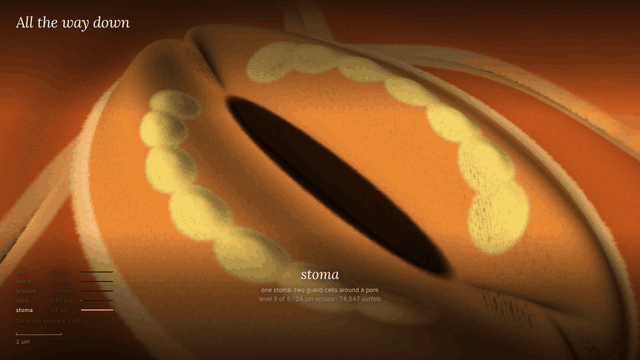

# All the way down

11-second loop. Click for the MP4 (1280×720, 1.9 MB); the GIF above is 640×360, 5.9 MB.

A multi-scale 3D viewer that runs in the browser and implements the **scale-aware opacity modulation** of WonderZoom (Jin Cao\*, Hong-Xing Yu\*, Jiajun Wu, *WonderZoom: Multi-Scale 3D World Generation*, [arXiv:2512.09164](https://arxiv.org/abs/2512.09164), 2025). It shows one autumn maple leaf at five scales, each ten times finer than the last: the leaf (24 cm field), its veins (2.4 cm), the areoles (2.4 mm), the pavement cells (240 µm) and a single stoma (24 µm). Scroll or pinch through 4.5 orders of magnitude and drag to orbit. A toggle turns modulation off, so you can see what the method prevents.

The method is the paper's. The viewer and the scene were written for this piece, not taken from the paper's code.

## Open it

Open `all-the-way-down.html` in a recent browser. It is one file of about 57 kB (20 kB gzipped) with no data files: the scene is generated in a Web Worker in about 1–2 s. It loads three.js 0.147.0 from jsDelivr and Lora and Inter from Google Fonts (with fallbacks); everything else is inline. No server is needed.

- **Scroll or pinch** to zoom, **drag** to orbit.
- **Dive** runs from the leaf to the stoma in about 8 s, slowing at each level and naming it (press it again to stop). Once you are deep in, the same button reads **Surface** and takes you back up.
- **Modulation on / off** (<kbd>M</kbd>) switches between the method and the naive union of all five levels.
- **Measure** times both modes at the current view and fills a small table (surfels drawn, estimated memory, fps). The table belongs to that one view and clears when the camera moves.
- **How it works** (top right) opens the method, the numbers and the limits; × or <kbd>Esc</kbd> closes it.
- With `prefers-reduced-motion`, zoom easing and the Dive become instant jumps.

## The scene: procedural, not WonderZoom's

The pretrained WonderZoom scenes are on Hugging Face (`TmaKiss/WonderZoom`): ten PyTorch files of 285 MB to 1.8 GB. They could not be downloaded where this was built, so **the scene is a procedural test scene made for this piece, not a WonderZoom output.** The rendering method is the point, and it does not depend on where the surfels come from.

- Each level *k* has its own "creation camera" straight above the zoom target, at distance D_k = 22.6 cm / 10^k with f = 1024 px.
- Level 0 covers the whole leaf. Each deeper level covers only a disk of radius 0.7·D_k around the target, which is WonderZoom's situation too: fine detail exists only where someone zoomed in.
- Surfels sit on a jittered hex grid, about 5 px apart at their native scale. Each level samples one analytic leaf, box-filtered at its own pixel footprint, so a coarse level is the average of the detail beneath it. The leaf has a lobed, serrated outline, curved secondary veins, a tertiary vein network, areoles, jigsaw pavement cells, and stomata with guard cells, chloroplasts and a pore.
- Relief comes from smooth distance fields with slopes below about 1 (cushion-shaped guard cells, a pore groove, soft chloroplast bumps), because a flat surfel grid cannot cover a near-vertical wall.
- Totals: 12,141 + 52,764 + 74,558 + 74,546 + 74,547 = **288,556 surfels**.

## What comes from the paper, and what does not

**From the paper and its official code** (checked against `gaussian_renderer/__init__.py` in [jin-cao-tma/WonderZoom](https://github.com/jin-cao-tma/WonderZoom)):
- **Surfels**: flattened Gaussians with position, orientation, in-plane scale, opacity, view-independent colour and a stored native scale; Σ = Q diag(s², s², ε²) Qᵀ.
- **Eq. 1**: native scale = depth to the creation camera / focal length. Parent and child scales use the adjacent levels' cameras; the render scale uses the current camera, per surfel.
- **Eq. 2–3**: rendered opacity õ = o·α, with α interpolating linearly in log scale: 1 at the native scale, 0 at the parent or child scale, and 1 beyond the coarsest and finest levels.
- **Prop. 1**: between adjacent levels the two α values sum to 1. The implementation gives α = 0.50 / 0.50 at the midpoint and Σα = 1.00 at every view tested.
- **Culling** surfels whose α has gone to zero, before rasterization. The official code culls at w > 1e-2; this viewer drops any surfel whose 8-bit opacity rounds below 1/255. The savings come from this step.

**Written for this piece:**
- **The WebGL renderer.** The vertex shader projects each flattened Gaussian with the EWA Jacobian, adds a 0.3 px² low-pass with Mip-Splatting-style energy compensation, and draws a quad sized to the projected ellipse. On each camera change the CPU evaluates α, frustum-culls, runs a 16-bit log-depth counting sort and uploads only the drawn set.
- **A spatial feather**, an extension that is not in the paper. Eq. 3 assumes the child level covers its parent everywhere; here each finer level is a local patch, so a coarse surfel fades by child coverage times the child weight, α = 1 − w_c·(1 − α_child), and each patch feathers its own rim. With w_c = 1 this is exactly the paper's equation, and it keeps Prop. 1 true at a patch's edge.
- **The memory estimate**: 32 B per drawn surfel plus 12 B per (surfel, 16×16 tile) pair, the lists a 3DGS-style tile rasterizer would allocate. It is a model, not a measurement; WebGL cannot report GPU memory.
- The procedural leaf, the scale ladder, the scale bar, the Dive tour and the rest of the interface.
- **Two differences from the paper's setup**: the paper multiplies focal length by 8 per scale, while this viewer moves the camera 10× closer per scale; and the paper optimizes opacity, orientation and scale from generated images, while here they are analytic.

## Measured: modulation on vs. off

On a real GPU: Chrome 157 on an Apple M5 Pro (WebGL through ANGLE on Metal), 1800×1226 drawing buffer, the page's own Measure routine, 120 frames per mode. Raw numbers are in [`gpu-measurements.txt`](gpu-measurements.txt).

| view | modulation on | modulation off |
|---|---|---|
| whole leaf | 50,363 surfels, 4.0 MB est., **496 fps** | 288,556 surfels, 23.1 MB est., **54 fps** |
| areoles (2.15 decades in) | 132,406 surfels, 16.1 MB, 684 fps | 210,994 surfels, 29.2 MB, 179 fps |
| stoma (4 decades in) | 74,817 surfels, 13.1 MB, 612 fps | 76,078 surfels, 23.3 MB, 624 fps |

- **Zoomed out**, modulation drops the fine surfels that would be sub-pixel: about 5.7× fewer surfels and 9× the frame rate.
- **Zoomed in**, frustum culling already removes most coarse surfels, so the surfel count and speed barely change. The few coarse surfels left are screen-sized, which still costs memory (13.1 vs 23.3 MB est.).
- **The visual effect is the larger one there.** With modulation off, coarse surfels sit at the same depth as the fine ones and blur over them.
- For comparison, the paper reports 7.96 GB and 1.4 FPS without modulation against 3.40 GB and 97.2 FPS with it (Table 3), on its own scenes with a CUDA rasterizer. The gains here are smaller because this scene is small (289k surfels against millions), only five levels deep, and each deeper level covers only a local patch.
- Under software WebGL (headless Chromium on SwiftShader, 2 shared CPU cores), the same comparison gave 5.5× less estimated memory and 4.2–7.3× faster frames with the whole leaf in view.

## Limits

- **No real WonderZoom scene**, for the reason above. The next step would be a converter from their `.pth` files (keeping position, rotation, scale, opacity, colour and the stored native, prior and next scales) to a packed binary; the renderer already takes exactly those fields.
- **Memory is an estimate** from a stated model. The GPU frame rates come from one machine, one browser and one session.
- **The CPU work is O(N) per camera change**: α, culling and the counting sort took about 5–40 ms for 289k surfels under software WebGL. A scene with millions of surfels would need this in a worker or on the GPU.
- **Sorting is by surfel centre depth, not per pixel.** This is standard for WebGL splatting but not exact.
- **The cross-fade is not perfectly flat.** The weights sum to 1, but alpha compositing is not additive, so mean brightness at the zoom target dips about 4% at the exact midpoint between two levels.
- **"Modulation off" is the naive union of all levels**, not a model retrained without modulation, which is what the paper's ablation does.
- **Narrow screens see a smaller field at each native scale**, because native scale is tied to the pixel footprint. A 375 px viewport shows about 8 µm across at the stoma level; the Dive turns the camera so the 26 µm stoma runs along the tall side.

## In this repository

- `all-the-way-down.html`: the piece (there is no build step)
- `gpu-measurements.txt`: the real-GPU timing run
- `screenshots/`: the first view, the leaf, the areoles with modulation on and off, the stoma, and the phone layout
- `loop/`: the loop video, its GIF and a poster

The headless check script is not included in this repository.

## Credits and license

WonderZoom: Jin Cao, Hong-Xing Yu and Jiajun Wu, arXiv:2512.09164, 2025. EWA splatting: Zwicker, Pfister, van Baar & Gross, 2001. three.js is MIT; the fonts are under the SIL Open Font License.

Code: MIT. See [LICENSE](LICENSE).

Built with Claude for Joe Gao.
